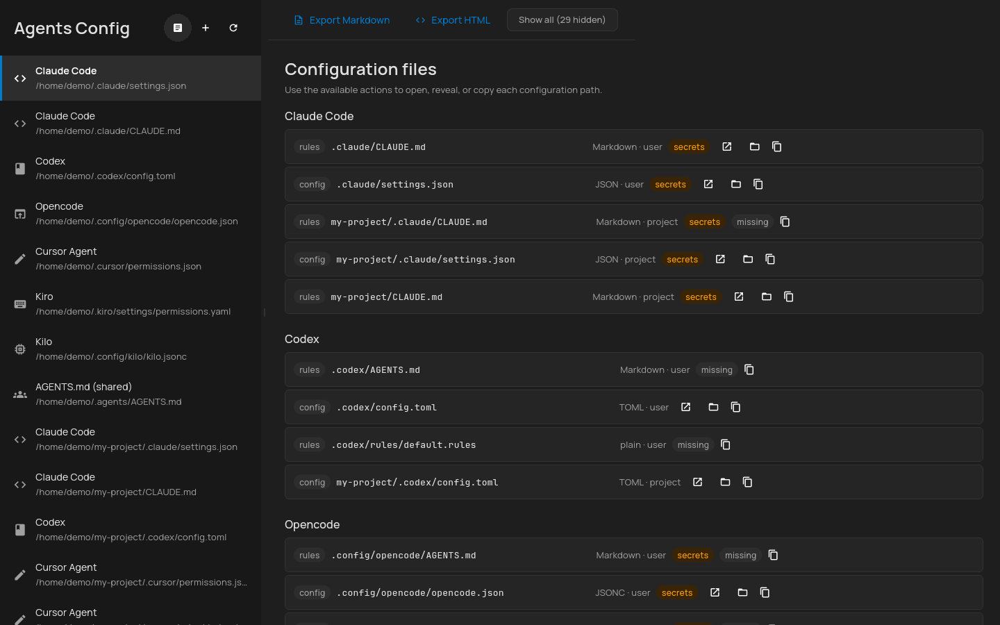
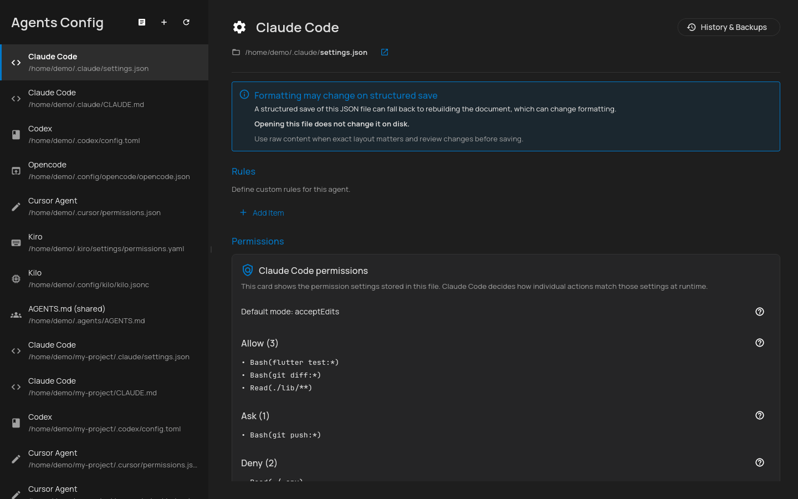
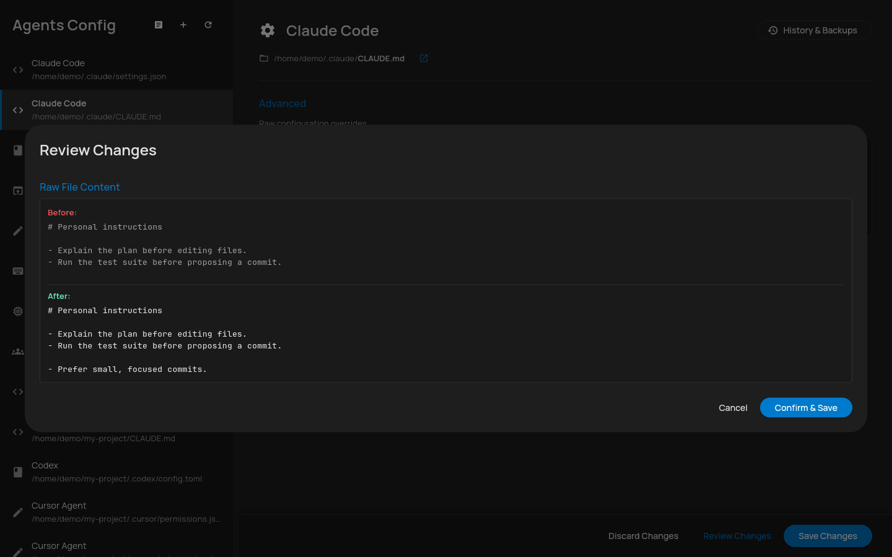
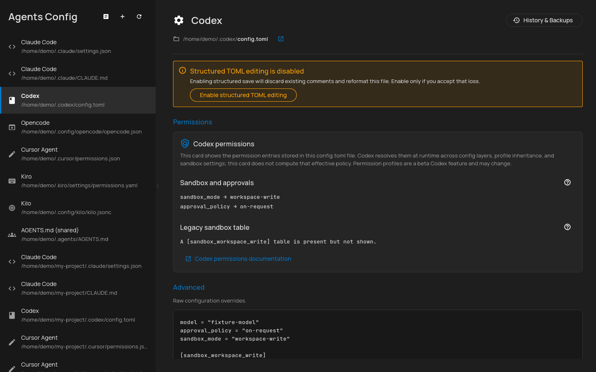
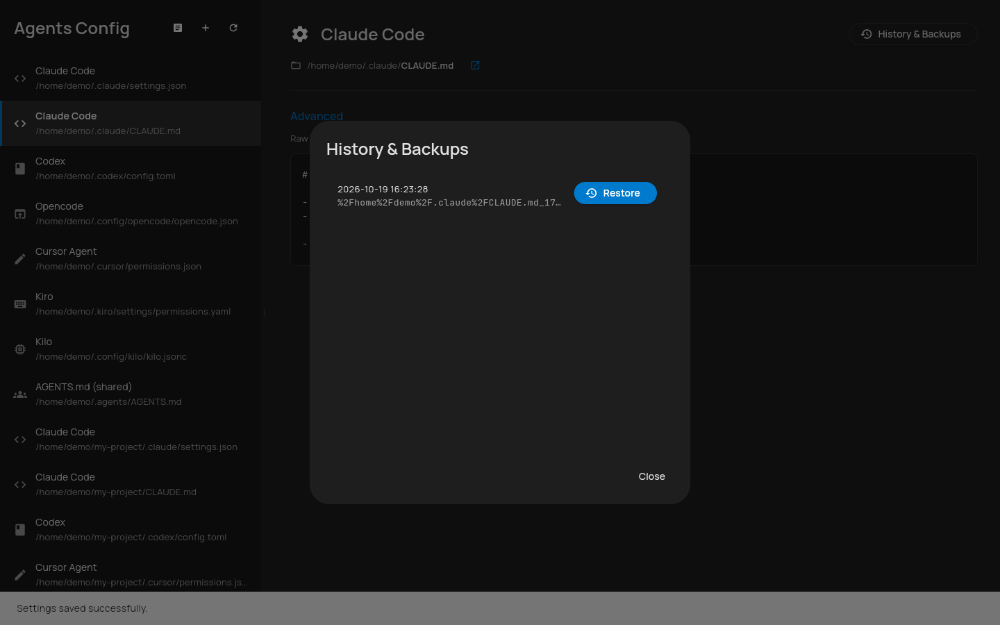

# AgentsConfigHelper

Last reviewed: 2026-10-19

[](https://github.com/kgrizz-git/AgentsConfigHelper/actions/workflows/ci.yml)
[](LICENSE)


A cross-platform desktop application for visualizing, editing, and managing configuration settings, rules, and permissions for AI agents and IDEs.

> **Under development — use at your own risk.** AgentsConfigHelper is pre-1.0 and under active
> development. It is provided "as is," without warranty of any kind. Because it reads and writes your
> real AI-agent and IDE configuration files (with automatic, timestamped backups), you use it entirely
> **at your own risk**. Always review pending changes and keep your backups before relying on it for
> production configuration.

**Project status:** Early development (0.2.0)



<!-- Screenshots are taken from the Linux build against synthetic demo configs based on `test/fixtures/`, never real configs. -->

## Why

Different AI tools scatter their configuration across `~/.claude/`, `~/.codex/`, `.cursor/`, `~/.config/opencode/`, and more — in four different formats (JSON, JSONC, YAML, TOML) with divergent permission models. AgentsConfigHelper gives you a single interface to find, view, and safely edit all of them.

## Features

### Available now

- **Config Discovery** — Automatically detects common configuration paths on first launch (e.g. `~/.claude/settings.json`, `.cursorrules`). Users can also add custom paths and project roots manually.
- **Structured config editing (JSON/JSONC, YAML, TOML)** — JSON/JSONC and YAML use
  in-place edits where supported. If a save cannot preserve the file in place, it
  stops before writing anything and asks before rewriting the whole document.
  Structured TOML editing is opt-in (read-only by default) because TOML saves
  rebuild the file and discard comments. Review Changes before saving any
  structured config.
- **Instruction document editing (Markdown/text)** — Raw text editing for `CLAUDE.md`, `AGENTS.md`, `.mdc` rules, and similar instruction files. Content is never reformatted or rewritten.
- **Permission cards (read-only)** — Plain-language views of the stored permission
  rules for Claude Code (`allow` / `ask` / `deny` and default mode), Codex (sandbox,
  approval policy, and `[permissions.*]` profiles), Opencode (`permission` block),
  and Cursor Agent (`permissions.json` allowlists), each linking to the official
  docs. Cards never write; anything they do not recognize stays editable in the raw editor.
- **Edit Safety** — Local-only file operations with a strict backup-before-write policy. Diff preview before every write, plus timestamped backups with one-click restore. Files that fail to parse open a recovery dialog (raw edit, view backups, skip) with line/column error positions, and are never auto-overwritten.
- **Config Overview Report** — A grouped, action-first tree of every discovered and known config, permissions, and rules file, with secret warnings on the affected rows and a reveal action that shows the file in Finder, Explorer, or your file manager without opening it. Targets for other operating systems or unused tools are hidden by default (**Show all** reveals them). Export as Markdown or self-contained HTML.
- **Cross-Platform** — Built in Flutter/Dart, targeting macOS, Windows, and Linux from a single codebase.

### Planned

- **CLI Integration Service** — Interfaces with agent CLIs (e.g. `claude config`, `opencode set`) when file-based edits are not sufficient.
- **Config Validation** — Schema validation before saving (parse errors are already reported with line and column).
- **Templates & Syncing** — Save, load, and merge configuration templates across tools. See Phase 7 of the [master plan](plans/active/initial_master_plan.md).

## Screenshots

| Permission cards | Review Changes before every save |
| --- | --- |
|  |  |
| **Opt-in TOML editing** | **Timestamped backups** |
|  |  |

## Supported tools

AgentsConfigHelper supports the following tools. See [`docs/supported-tools.md`](docs/supported-tools.md) for the full configuration reference, config paths, and permission models for each tool.

Every location below is discovered and editable. Structured config saves can reformat a
file depending on its format and the serialization path; rules and instruction documents
get raw text editing. A `—` means the tool has no location of that kind.

| Tool | Formats | User config | Project config | Rules / instruction docs |
| --- | --- | --- | --- | --- |
| Claude Code | JSON + Markdown | `~/.claude/settings.json` | `.claude/settings.json` | `~/.claude/CLAUDE.md`, `CLAUDE.md`, `.claude/CLAUDE.md` |
| Codex | TOML + Starlark rules + Markdown | `~/.codex/config.toml` | `.codex/config.toml` | `~/.codex/rules/default.rules`, `.codex/rules/*.rules`, `~/.codex/AGENTS.md` (+ shared `AGENTS.md`) |
| Opencode | JSONC + Markdown | `~/.config/opencode/opencode.json` | `.opencode/opencode.json` | `~/.config/opencode/AGENTS.md` (+ shared `AGENTS.md`) |
| Paseo | JSON | `~/.paseo/config.json` | `paseo.json` | — |
| Cursor IDE | JSON | `Cursor/User/settings.json` (per-OS app-support path) | `.cursor/settings.json` | — |
| Cursor Agent | JSON + text/Markdown | `~/.cursor/permissions.json` | `.cursor/permissions.json` | `.cursor/rules/*.mdc`, `.cursorrules`, `CLAUDE.md` (+ shared `AGENTS.md`) |
| Kiro | YAML + Markdown | `~/.kiro/settings/permissions.yaml` | — | `.kiro/steering/*.md` (+ shared `AGENTS.md`) |
| Devin | JSON + Markdown | `~/.config/devin/config.json` | `.devin/config.json` | `~/.config/devin/AGENTS.md`, `.devin/rules/*.md` (+ shared `AGENTS.md`) |
| Antigravity IDE | JSON | `~/.gemini/antigravity-ide/settings.json` | — | — |
| Antigravity App | JSON | `~/.gemini/antigravity-app/settings.json` | — | — |
| Antigravity CLI | JSON + Markdown | `~/.gemini/antigravity-cli/settings.json` | — | `~/.gemini/GEMINI.md`, `GEMINI.md`, `.agents/rules/*.md` |
| Agy-ACP | JSON | `~/.openab/agy-acp/sessions.json` | — | — |
| Kilo | JSONC + Markdown | `~/.config/kilo/kilo.jsonc` (or `kilo.json`) | `kilo.jsonc` / `.kilo/kilo.jsonc` | `~/.config/kilo/AGENTS.md`, `~/.config/kilo/agents/*.md`, `.kilo/agents/*.md` (+ shared `AGENTS.md`) |
| Cline | JSON + Markdown | `~/.cline/data/settings/global-settings.json` (+ MCP and provider settings) | — | `~/Documents/Cline/Rules/` (or `~/Cline/Rules/`), `~/.cline/rules/*.md`, `.clinerules/`, `.clinerules`, `.cline/rules/*.md` (+ shared `AGENTS.md`) |
| LM Studio | JSON + YAML | `~/.lmstudio/settings.json` | — | hub `model.yaml` / presets (weights not discovered) |
| GitHub Copilot | JSONC + Markdown | `~/.copilot/settings.json` (+ managed `config.json`, `mcp-config.json`) | `.github/copilot/settings.json` (+ `settings.local.json`) | `~/.copilot/copilot-instructions.md`, `.github/copilot-instructions.md`, `~/.copilot/instructions/**/*.instructions.md`, `.github/instructions/**/*.instructions.md` (+ shared `AGENTS.md`) |
| AGENTS.md (shared) | Markdown | `~/.agents/AGENTS.md` | `AGENTS.md` | Cross-tool [agents.md](https://agents.md/) convention |

## Getting Started

### Prerequisites

- **Flutter SDK** >= 3.47.1 ([install guide](https://docs.flutter.dev/get-started/install))
- **Dart SDK** >= 3.13.1 (bundled with Flutter)
- **macOS source builds:** macOS 12 (Monterey) or later
- **Linux only:** `ninja-build` and `libgtk-3-dev` (required for building the native shell)

  ```bash
  sudo apt-get install -y ninja-build libgtk-3-dev
  ```

### Run from source

```bash
flutter pub get
flutter run -d macos  # or windows / linux
```

### macOS source-build scope

macOS is currently supported through local source builds only. To discover and
edit configuration files in the real user home and project directories, these
builds are intentionally not App Sandbox confined. No prebuilt macOS app,
disk image, installer, or release zip is published from this project until a
separate Developer ID signing and notarization plan exists.

If you used an earlier sandboxed source build, its manual discovery paths and
in-app backup history may remain in the old app container rather than appearing
in the new build. Your original configuration files are never moved or
modified by this transition.

### Build release binary

```bash
flutter build macos --release    # or linux / windows
```

## How it works / Safety model

- **Backup location:** Backups are stored in a centralized application-support directory, not alongside the original files:
  - macOS: `~/Library/Application Support/<bundle-id>/backups`
  - Linux: `~/.local/share/<app>/backups` (or `$XDG_DATA_HOME`)
  - Windows: `%APPDATA%\<app>\backups`

- **Backup retention:** The newest 10 snapshots per original file path are retained. Older backups are pruned best-effort after each save. Filenames encode the original absolute path (including usernames and project names). Backups are byte-for-byte copies of the original file, so any secret embedded in the source config — including inside comments (e.g. `// API key: sk-...`) — is duplicated verbatim into both the updated file and the backup. The backup directory lives outside `~/.claude/`, `~/.codex/`, and other tool-specific config directories, so whatever permissions or tooling protect those paths do not extend to backups.

- **Diff before write:** A diff preview is shown before every save. There is no in-session undo stack; the revert path is timestamped backup restore via the History & Backups view.

- **Comment preservation:** JSON/JSONC and YAML first attempt in-place source edits
  (`json_ast`, `yaml_edit`) for supported changes, preserving unrelated source text on
  that path. If the preserving path fails, the save is blocked before writing
  anything and the user must explicitly allow a rewrite (default is raw editing).
  TOML serialization is lossy (see [ADR-001](docs/adr/ADR-001-toml-comment-preservation.md))
  and TOML structured editing is opt-in, off by default.

- **Data classification: Internal.** Config files may contain tokens or sensitive local paths. All file parsing and visualization happens strictly locally on the machine. Nothing is ever transmitted to the cloud or committed to the repository (beyond synthetic fixtures for testing).

- **Purging backups:** Delete the contents of the backup directory listed above to remove all snapshots.

## Development

### Commands

```bash
flutter pub get                              # install dependencies
flutter analyze --fatal-infos                # lint + type check
dart format --output=none --set-exit-if-changed .  # format check
flutter test                                 # run tests
flutter test --coverage                      # run tests with coverage
```

### Quality gates

The CI pipeline enforces:

- `dart format` (Dart formatter)
- `flutter analyze --fatal-infos` (static analysis)
- `dart_code_linter:metrics` at warning level
- **80% minimum line coverage** (vendor code excluded)
- `gitleaks` full-history secret scan
- `semgrep` SAST scan (non-blocking, results in Security tab)
- Docs integrity check (internal links + supported-tools catalog vs. the tool registry)
- macOS entitlements check (App Sandbox must stay off for source builds)
- **3-OS release build matrix** (macOS, Linux, Windows)

A separate weekly workflow audits `pubspec.lock` with OSV-Scanner and checks pinned
GitHub Actions for known vulnerabilities with zizmor.

### Pre-commit hooks

```bash
pre-commit install
pre-commit run --all-files
```

Hooks include `gitleaks`, `markdownlint`, `shellcheck`, and repo hygiene checks. See [`hooks/README.md`](hooks/README.md).

## Contributing

See [`AGENTS.md`](AGENTS.md) for the agent/developer contract, conventions, and key file reference. See [`ARCHITECTURE.md`](ARCHITECTURE.md) for the system architecture overview.

## License

This project is licensed under the [MIT License](LICENSE).

The vendored `lib/vendor/json_ast/` library is also MIT-licensed (copyright 2019 json_ast authors). See [`lib/vendor/json_ast/LICENSE`](lib/vendor/json_ast/LICENSE).
